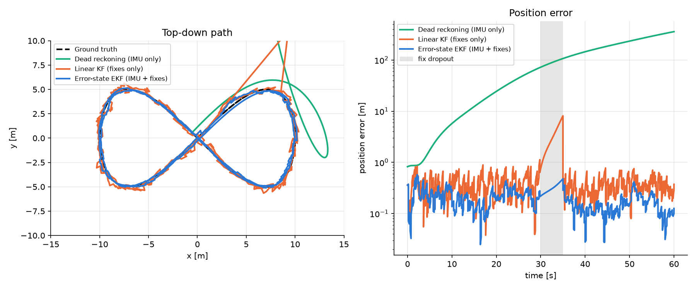
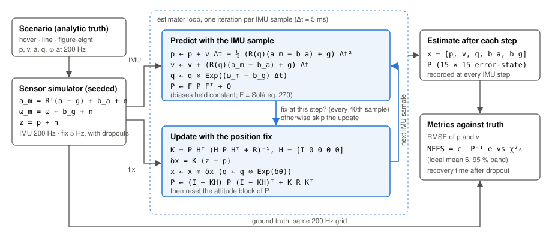
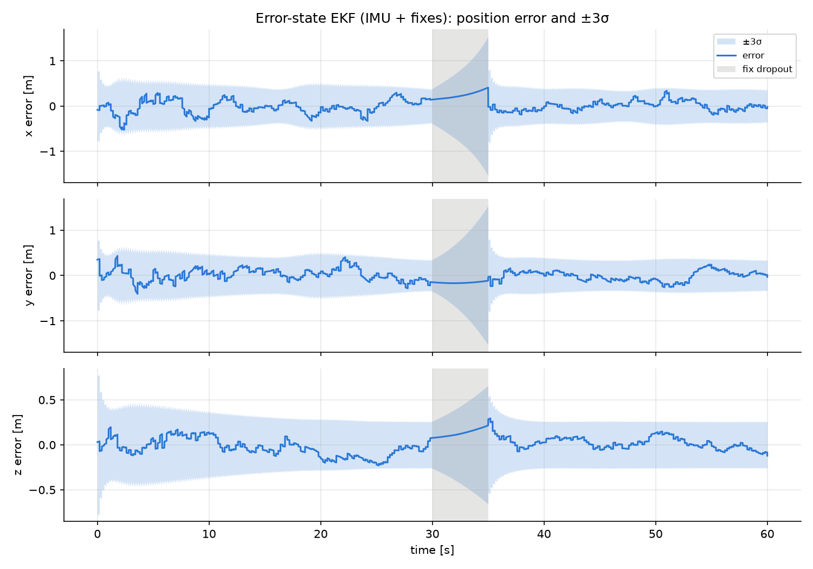
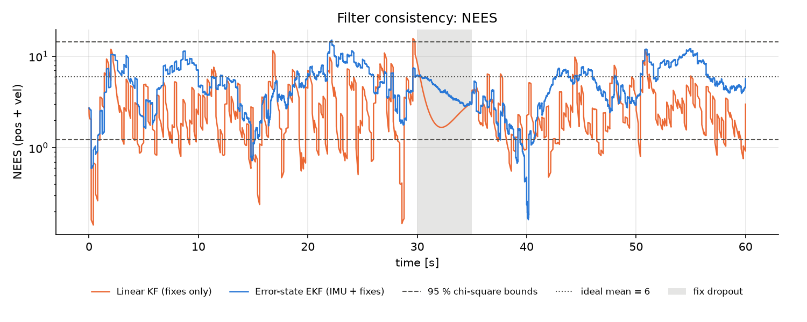

# dronefuse

**Sensor fusion for a simulated quadrotor: an error-state EKF that fuses a 200 Hz IMU with 5 Hz position fixes, validated against dead reckoning and a linear Kalman filter.**



Figure-eight, 60 s, seed 0, position fixes dropped between 30 s and 35 s (grey band):

| Estimator | Pos RMSE [m] | Vel RMSE [m/s] | Max pos err [m] | Mean NEES (ideal 6) | NEES in 95 % bounds |
|---|---:|---:|---:|---:|---:|
| DR | 151.617 | 7.304 | 358.71 | n/a | n/a |
| KF | 1.200 | 0.879 | 8.11 | 3.01 | 82.5 % |
| EKF | 0.218 | 0.135 | 0.58 | 5.25 | 96.0 % |

- The EKF's position error is about **700× lower** than dead reckoning and 5× lower than the linear KF.
- Its uncertainty is **honest**: the NEES (normalised estimation error squared, `eᵀ P⁻¹ e`) has a mean close to the ideal 6 and stays inside the 95 % chi-square band. A filter that is merely confident fails this test; the linear KF does.
- During the 5 s dropout the error grows smoothly to 0.58 m and is back under 0.5 m at the **first fix** after it returns.

Without the dropout (the acceptance case in `tests/test_acceptance.py`) the EKF reaches 0.204 m RMSE. Its NEES fraction for seed 0 alone is 87.8 %; over seeds 0–7 it averages 94.2 % with mean NEES 5.85, which is why the consistency test pools several seeds instead of tuning the filter to one.

## Quick start

```bash
uv sync --all-groups
uv run dronefuse run --scenario figure8 --estimator all --seed 0 --dropout 30:35
# prints the metrics table; writes hero_figure8.png, errors_ekf.png, errors_kf.png, nees.png to out/
uv run dronefuse sweep --knob ekf.gyro_noise_std --values 1,2,4 --scale --seeds 0,1,2
# reruns with one knob scaled, averaged over seeds; writes out/sweep_ekf.gyro_noise_std.md
uv run pytest
```

Scenarios: `hover`, `line`, `figure8`. Estimators: `dr`, `kf`, `ekf`, `all`. Sweep knobs are `sensor.*`, `init.*`, `kf.*`, `ekf.*` config fields.

## What is modelled



**Truth.** A scripted path with closed-form position, velocity and acceleration (hover, straight line, or a 10 m × 5 m figure-eight with 30 s period at ~2 m/s). Yaw follows the horizontal velocity; roll and pitch are zero. No physics engine, no controller.

**Sensors** (seeded, so every estimator sees the same log):

| Sensor | Rate | Model |
|---|---|---|
| Accelerometer | 200 Hz | specific force `a_m = R(q)ᵀ (a − g) + b_a + n_a`, reads `[0, 0, +9.81]` at rest; white noise 0.05 m/s², bias random walk |
| Gyroscope | 200 Hz | `ω_m = ω + b_g + n_g`; white noise 0.002 rad/s, bias random walk |
| Position fix | 5 Hz | `z = p + n`, 0.3 m per axis; optional dropout intervals |

**Conventions.** World frame z-up, `g = [0, 0, −9.81]`. Quaternions `(w, x, y, z)`, Hamilton product, `q` maps body → world. Attitude error is local: `q_true = q ⊗ Exp(δθ)` (Solà 2017).

## The three estimators

All three implement `predict(imu, dt)` / `update(fix)` / `estimate` and run over the same log.

1. **Dead reckoning** integrates the IMU and ignores fixes. Biases integrate into metres within seconds.
2. **Linear KF** uses a constant-velocity model on `[p, v]` with white-noise acceleration and sees only the fixes. It lags in turns and cannot predict through a dropout.
3. **Error-state EKF** keeps a nominal state `x = [p, v, q, b_a, b_g]` and a 15-dimensional error state `δx = [δp, δv, δθ, δb_a, δb_g]`. Every IMU sample propagates

   ```
   p ← p + v Δt + ½ (R(q)(a_m − b_a) + g) Δt²
   v ← v + (R(q)(a_m − b_a) + g) Δt
   q ← q ⊗ Exp((ω_m − b_g) Δt)          biases constant
   P ← F P Fᵀ + Q
   ```

   with `F` the error-state Jacobian (Solà eq. 270, checked against finite differences in the tests) and `Q` from the IMU white-noise and bias-walk densities. Each fix is a linear measurement of `δp`: Kalman gain in Joseph form, `δx = K (z − p)`, inject into the nominal state, reset the attitude covariance.

The EKF's `Q`, `R` and `P0` are built from the simulator's own noise numbers. That is the honest choice for a simulation study and is what makes the consistency test meaningful.





## Not modelled

Magnetometer, barometer or airspeed; vehicle dynamics, aerodynamics or a controller; IMU scale factors, misalignment, lever arm and time offsets; Earth rotation; fix outliers; real-time constraints. Yaw is observable only through horizontal acceleration, so on hover the yaw uncertainty grows, which is correct. Integration is first order with the IMU sample held over the 5 ms step. See [docs/design.md](docs/design.md) for the full list and the numbers.

## Layout

```
dronefuse/
  scenario.py          analytic truth: Hover, Line, FigureEight
  sensors.py           SensorConfig, seeded IMU + position-fix simulator
  simulate.py          truth sampling, sensor log, run_estimator loop
  quaternion.py        Exp/Log, Hamilton product, rotation matrix
  estimators/
    base.py            Estimate, InitialState, Estimator protocol
    kinematics.py      strapdown step shared by DR and EKF
    linalg.py          Joseph-form Kalman update
    dead_reckoning.py  kf.py  ekf.py
  metrics.py           RMSE, NEES, chi-square bounds, dropout recovery
  pipeline.py          scenario → sensors → estimators → metrics
  sweep.py             parameter sweeps with per-filter overrides
  plots.py  cli.py
tests/                 unit tests per module + SPEC §4 acceptance tests
notebooks/walkthrough  raw sensors → DR drift → KF → EKF, step by step
docs/design.md         models, noise parameters, decisions, limitations
```

numpy + scipy + matplotlib only; the full run takes about 3 s.
